# Database

This diagram shows the tables of the kit, their columns, and their foreign keys. `php artisan docs:generate` draws it from the migrations, and `composer test` fails when the page does not match them. The diagram leaves out the tables of the framework, such as the cache, job, and session tables.

A foreign key with its own unique index draws a one-to-one line. A partial or expression unique index does not, because it allows many rows with the same key. An example is the placement index of `letterheads`.

```mermaid
erDiagram
    actions {
        integer id PK
        string resource_type
        integer resource_id
        string actor_type
        integer actor_id
        integer profile_id FK
        string name
        datetime acted_at
        datetime created_at
        datetime updated_at
    }
    activity_log {
        integer id PK
        string log_name
        text description
        string subject_type
        integer subject_id
        string event
        string causer_type
        integer causer_id
        json attribute_changes
        json properties
        datetime created_at
        datetime updated_at
    }
    addresses {
        integer id PK
        string addressable_type
        integer addressable_id
        integer country_id FK
        integer state_id FK
        integer district_id FK
        integer subdistrict_id FK
        integer post_office_id FK
        string type
        string line_1
        string line_2
        string line_3
        string postcode
        decimal latitude
        decimal longitude
        json properties
        datetime created_at
        datetime updated_at
        datetime deleted_at
    }
    branches {
        integer id PK
        integer organization_id FK
        string code
        string name
        boolean is_owner
        datetime created_at
        datetime updated_at
        datetime deleted_at
    }
    countries {
        integer id PK
        string code
        string name
        string alpha_2
        datetime created_at
        datetime updated_at
        datetime deleted_at
    }
    departments {
        integer id PK
        integer organization_id FK
        string code
        string name
        boolean is_owner
        datetime created_at
        datetime updated_at
        datetime deleted_at
    }
    districts {
        integer id PK
        integer state_id FK
        string code
        string name
        datetime created_at
        datetime updated_at
        datetime deleted_at
    }
    letterheads {
        integer id PK
        integer organization_id FK
        integer branch_id FK
        integer department_id FK
        string name
        datetime created_at
        datetime updated_at
        datetime deleted_at
    }
    letters {
        integer id PK
        string type
        string source_type
        integer source_id
        string reference_number
        string sequence_key
        integer sequence_number
        integer sequence_cycle
        date date
        json carbon_copies
        json extra
        boolean with_letterhead
        boolean computer_signed
        datetime created_at
        datetime updated_at
        datetime deleted_at
    }
    mail_links {
        integer id PK
        integer message_id FK
        string token
        text url
        boolean requires_auth
        datetime clicked_at
        datetime viewed_at
        datetime created_at
        datetime updated_at
        datetime deleted_at
    }
    media {
        integer id PK
        string model_type
        integer model_id
        string uuid
        string collection_name
        string name
        string file_name
        string mime_type
        string disk
        string conversions_disk
        integer size
        json manipulations
        json custom_properties
        json generated_conversions
        json responsive_images
        integer order_column
        datetime created_at
        datetime updated_at
    }
    messages {
        integer id PK
        string channel
        string notification_id
        string notification_type
        text payload
        string notifiable_type
        integer notifiable_id
        string resource_type
        integer resource_id
        text recipient_address
        string recipient_name
        json cc
        json bcc
        string intercepted_to
        text subject
        text html_body
        text text_body
        string provider_id
        string status
        json error
        boolean tracked
        string tracking_token
        integer open_count
        datetime opened_at
        datetime clicked_at
        datetime viewed_at
        datetime sent_at
        datetime failed_at
        integer resend_of_id FK
        datetime created_at
        datetime updated_at
        datetime deleted_at
    }
    model_has_permissions {
        integer permission_id PK, FK
        string model_type PK
        integer model_id PK
    }
    model_has_roles {
        integer role_id PK, FK
        string model_type PK
        integer model_id PK
    }
    notifications {
        string id PK
        string type
        string notifiable_type
        integer notifiable_id
        json data
        datetime read_at
        datetime created_at
        datetime updated_at
    }
    organizations {
        integer id PK
        string code
        string name
        boolean is_owner
        datetime created_at
        datetime updated_at
        datetime deleted_at
    }
    passkeys {
        integer id PK
        integer user_id FK
        string name
        string credential_id
        json credential
        datetime last_used_at
        datetime created_at
        datetime updated_at
    }
    permissions {
        integer id PK
        string name
        string guard_name
        datetime created_at
        datetime updated_at
    }
    positions {
        integer id PK
        integer organization_id FK
        integer department_id FK
        string name
        datetime created_at
        datetime updated_at
        datetime deleted_at
    }
    post_offices {
        integer id PK
        integer state_id FK
        string name
        datetime created_at
        datetime updated_at
        datetime deleted_at
    }
    postcodes {
        integer id PK
        integer post_office_id FK
        string code
        decimal latitude
        decimal longitude
        datetime created_at
        datetime updated_at
        datetime deleted_at
    }
    profiles {
        integer id PK
        integer organization_id FK
        integer department_id FK
        integer position_id FK
        integer branch_id FK
        integer user_id FK
        datetime created_at
        datetime updated_at
        datetime deleted_at
    }
    role_has_permissions {
        integer permission_id PK, FK
        integer role_id PK, FK
    }
    roles {
        integer id PK
        string name
        string guard_name
        boolean is_system
        datetime created_at
        datetime updated_at
    }
    running_number_skips {
        integer id PK
        integer running_number_id FK
        integer number
        string formatted_number
        string reason
        integer reset_cycle
        datetime used_at
        datetime created_at
        datetime updated_at
    }
    running_number_undos {
        integer id PK
        integer running_number_id FK
        integer number
        string formatted_number
        string mode
        string reason
        integer reset_cycle
        datetime reclaimed_at
        datetime created_at
        datetime updated_at
    }
    running_numbers {
        integer id PK
        string type
        string reset_interval
        integer reset_month
        integer reset_day
        integer reset_weekday
        integer reset_hour
        string timezone
        integer reset_cycle
        string undo_mode
        string format
        integer number
        integer padding
        datetime last_reset_at
        datetime created_at
        datetime updated_at
    }
    states {
        integer id PK
        integer country_id FK
        string code
        string name
        datetime created_at
        datetime updated_at
        datetime deleted_at
    }
    subdistricts {
        integer id PK
        integer district_id FK
        string code
        string name
        datetime created_at
        datetime updated_at
        datetime deleted_at
    }
    users {
        integer id PK
        string name
        string email
        datetime email_verified_at
        string password
        string remember_token
        datetime created_at
        datetime updated_at
        datetime deleted_at
        text two_factor_secret
        text two_factor_recovery_codes
        datetime two_factor_confirmed_at
        string timezone
        string language
        string locale
        string phone
        datetime phone_verified_at
    }
    branches |o--o{ letterheads : "branch_id"
    branches |o--o{ profiles : "branch_id"
    countries |o--o{ addresses : "country_id"
    countries ||--o{ states : "country_id"
    departments |o--o{ letterheads : "department_id"
    departments |o--o{ positions : "department_id"
    departments |o--o{ profiles : "department_id"
    districts |o--o{ addresses : "district_id"
    districts ||--o{ subdistricts : "district_id"
    messages ||--o{ mail_links : "message_id"
    messages |o--o{ messages : "resend_of_id"
    organizations ||--o{ branches : "organization_id"
    organizations ||--o{ departments : "organization_id"
    organizations ||--o{ letterheads : "organization_id"
    organizations ||--o{ positions : "organization_id"
    organizations |o--o{ profiles : "organization_id"
    permissions ||--o{ model_has_permissions : "permission_id"
    permissions ||--o{ role_has_permissions : "permission_id"
    positions |o--o{ profiles : "position_id"
    post_offices |o--o{ addresses : "post_office_id"
    post_offices ||--o{ postcodes : "post_office_id"
    profiles |o--o{ actions : "profile_id"
    roles ||--o{ model_has_roles : "role_id"
    roles ||--o{ role_has_permissions : "role_id"
    running_numbers ||--o{ running_number_skips : "running_number_id"
    running_numbers ||--o{ running_number_undos : "running_number_id"
    states |o--o{ addresses : "state_id"
    states ||--o{ districts : "state_id"
    states ||--o{ post_offices : "state_id"
    subdistricts |o--o{ addresses : "subdistrict_id"
    users ||--o{ passkeys : "user_id"
    users ||--o{ profiles : "user_id"
```

<!-- generated:erd -->

These polymorphic column pairs can point to any table, so the diagram draws no line for them:

- `actions.resource_type` and `actions.resource_id`
- `actions.actor_type` and `actions.actor_id`
- `activity_log.subject_type` and `activity_log.subject_id`
- `activity_log.causer_type` and `activity_log.causer_id`
- `addresses.addressable_type` and `addresses.addressable_id`
- `letters.source_type` and `letters.source_id`
- `media.model_type` and `media.model_id`
- `messages.notification_type` and `messages.notification_id`
- `messages.notifiable_type` and `messages.notifiable_id`
- `messages.resource_type` and `messages.resource_id`
- `model_has_permissions.model_type` and `model_has_permissions.model_id`
- `model_has_roles.model_type` and `model_has_roles.model_id`
- `notifications.notifiable_type` and `notifications.notifiable_id`

<!-- /generated:erd -->

## Geography Data

`GeographySeeder` fills the geography tables from the bundled data. It runs `address:seed`, and `db:seed` runs `GeographySeeder`.

Do not run `GeographySeeder`, `db:seed`, or `address:seed` after a deploy. The seed undoes edits made in the Geography control:

- An edited name goes back to the bundled name. So does the alpha-2 code of a country.
- An edited code, or an edited city name, makes a second row with the bundled key. The seed also adds all the bundled records below that row again.
